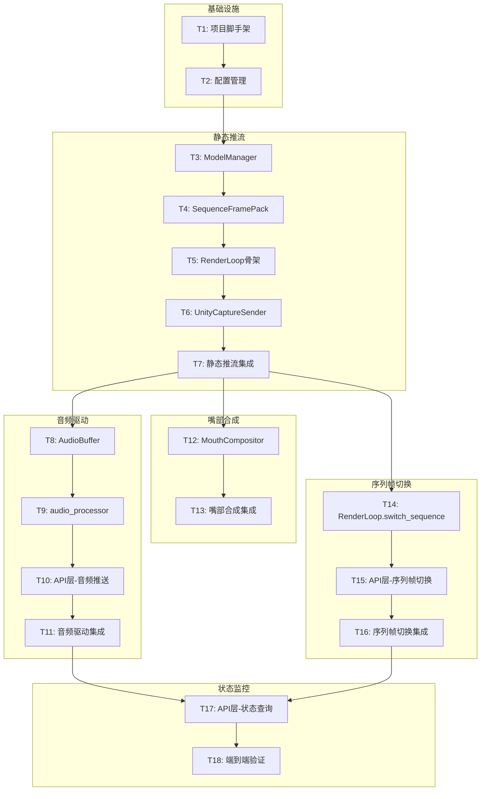

# 任务规划：实时流式推理服务

> 需求文档：`specs/features/realtime-streaming-inference.md`
> 技术方案：`specs/features/realtime-streaming-inference_技术方案.md`

## 1. 概述

| 指标 | 数值 |
|------|------|
| **总任务数** | 18 |
| **预估总工时** | 约 22-26 小时 |
| **切片数量** | 6（含基础设施） |
| **关键路径** | 基础设施 → 静态推流 → 音频驱动 → 嘴部合成 → 序列帧切换 → 状态监控 |

## 2. 切片策略

采用**垂直切片**策略，每个切片对应一个可独立验证的用户行为：

| 阶段 | 用户行为 | 核心 AC |
|------|---------|---------|
| 基础设施 | 项目可运行 | 无 |
| 静态推流 | 虚拟摄像头持续输出人物画面（无音频时嘴闭合） | AC-001, AC-005, AC-011, AC-014 |
| 音频驱动 | 推送音频后人物嘴部随音频运动 | AC-002, AC-003, AC-007, AC-008, AC-009, AC-016 |
| 嘴部合成 | 嘴部区域自然融合到原始帧 | AC-006, AC-015 |
| 序列帧切换 | 通过 API 切换序列帧包，推流不中断 | AC-004, AC-010 |
| 状态监控 | 查询服务运行状态 | AC-014 |

## 3. 依赖关系图



## 4. 详细任务清单

### 阶段一：基础设施

#### T1: 创建项目脚手架

| 属性 | 值 |
|------|-----|
| **通俗解释** | 创建推理服务的目录结构和入口文件，让项目可以"跑起来"（虽然还没功能） |
| **技术方案章节** | §7 项目文件结构 |
| **对应 AC** | 无（基础设施） |
| **预估工时** | 0.5h |

**验证标准：**

- **正常情况**：执行 `python -m realtime_serve.main --help` 返回参数解析帮助信息
- **边界情况**：删除 `realtime_serve/api/__init__.py` 后导入失败，提示缺少模块
- **异常情况**：目录权限不足时，创建目录操作抛出 `PermissionError`

**实现要点：**
- 创建 `realtime_serve/` 目录及子目录（api/, utils/）
- 创建 `__init__.py` 文件使各目录成为 Python 包
- 创建 `main.py` 作为入口点，包含 argparse 参数解析

---

#### T2: 实现配置管理

| 属性 | 值 |
|------|-----|
| **通俗解释** | 把模型路径、序列帧包路径等配置集中管理，避免散落在代码各处 |
| **技术方案章节** | §7 config.py |
| **对应 AC** | 无（基础设施） |
| **预估工时** | 0.5h |

**验证标准：**

- **正常情况**：`Config(model_path="ckpts/EDTalk_lip_pose.pt")` 成功创建对象，`config.model_path` 返回正确路径
- **边界情况**：传入不存在的路径时，`Config.__post_init__` 打印警告但不报错
- **异常情况**：必填字段缺失时抛出 `TypeError`

**实现要点：**
- 使用 `dataclasses` 定义 `Config` 类
- 包含字段：`model_path`, `audio2lip_path`, `default_dataset_dir`, `default_video_name`, `target_fps`
- 实现路径校验逻辑

---

### 阶段二：静态推流

#### T3: 实现 ModelManager

| 属性 | 值 |
|------|-----|
| **通俗解释** | 封装模型加载逻辑，让推理服务启动时自动加载 Audio2Lip 和 Generator 到显存 |
| **技术方案章节** | §4.2 |
| **对应 AC** | AC-011（启动失败处理） |
| **预估工时** | 1h |

**验证标准：**

- **正常情况**：`ModelManager(model_path, audio2lip_path).load()` 后，`manager.audio2lip` 和 `manager.gen` 均为 GPU tensor
- **边界情况**：模型文件损坏时，`torch.load` 抛出异常，`load()` 捕获后打印错误信息并退出
- **异常情况**：CUDA 不可用时，`device='cuda'` 抛出 `RuntimeError`，提示使用 CPU 模式

**实现要点：**
- 复用 `networks/audio_encoder.py:Audio2Lip` 和 `networks/generator_lip_pose.py:Generator`
- 参考 `demo_change_a_video_lip.py:168-175` 的加载逻辑
- 实现 `infer_lip()` 和 `infer_frame()` 方法

---

#### T4: 实现 SequenceFramePack

| 属性 | 值 |
|------|-----|
| **通俗解释** | 加载预处理好的序列帧包（原始帧+裁剪帧+坐标数据），支持按索引取帧 |
| **技术方案章节** | §4.3, §2.1-2.3 |
| **对应 AC** | AC-005（循环播放）、AC-011（启动失败） |
| **预估工时** | 1.5h |

**验证标准：**

- **正常情况**：`pack = SequenceFramePack("HDTF/subject_001", "video_clip_1")` 成功加载，`pack.total_frames > 0`，`pack.get_frame(0)` 返回 (orifra, cropped, meta, facemark) 四元组
- **边界情况**：`pack.get_frame(999999)` 返回实际存在的帧（取模循环）
- **异常情况**：路径不存在时抛出 `FileNotFoundError`，消息包含缺失路径

**实现要点：**
- 加载 orifra 帧（CPU numpy array，BGR uint8）
- 加载 cropped 帧到 GPU tensor（参考 `PreloadedVideoReader`）
- 加载 metadata.npy 和 facemark.npy
- `get_frame()` 实现循环取模逻辑

---

#### T5: 实现 RenderLoop 骨架

| 属性 | 值 |
|------|-----|
| **通俗解释** | 创建 25fps 主循环框架，目前只做"读帧→跳过推理→推流"的空转 |
| **技术方案章节** | §4.9, §4.1 |
| **对应 AC** | AC-001（25fps 推流）、AC-014（帧率控制） |
| **预估工时** | 1h |

**验证标准：**

- **正常情况**：启动后 `RenderLoop.run()` 持续运行，`loop.actual_fps` 在 23-27 fps 范围内波动
- **边界情况**：渲染耗时超过 40ms 时，下一帧自动跳过等待，不阻塞循环
- **异常情况**：调用 `loop.stop()` 后循环在 100ms 内退出

**实现要点：**
- 使用 `time.perf_counter()` 精确计时
- 实现帧间隔控制：`sleep_time = FRAME_INTERVAL - elapsed`
- 实现帧率监控：`self._actual_fps = 1.0 / max(elapsed, FRAME_INTERVAL)`

---

#### T6: 实现 UnityCaptureSender

| 属性 | 值 |
|------|-----|
| **通俗解释** | 通过 Windows 共享内存将合成后的帧写入 UnityCapture 虚拟摄像头 |
| **技术方案章节** | §4.7 |
| **对应 AC** | AC-012（虚拟摄像头未读取不阻塞） |
| **预估工时** | 1.5h |

**验证标准：**

- **正常情况**：`sender.send_frame(bgr_frame)` 成功写入，UnityCapture 虚拟摄像头显示对应画面
- **边界情况**：虚拟摄像头未打开时，mutex 等待超时 100ms 后跳过，不抛异常
- **异常情况**：传入非 BGR 格式数组时，`cv2.cvtColor` 抛出 `cv2.error`，被捕获后打印警告

**实现要点：**
- 参考 `UnityCapture-master/Source/shared.inl` 的共享内存协议
- 使用 `ctypes` 调用 Windows API（OpenMutexW, CreateEventW, OpenFileMappingW, MapViewOfFile）
- 实现 BGR→RGBA 转换和共享内存写入

---

#### T7: 静态推流集成测试

| 属性 | 值 |
|------|-----|
| **通俗解释** | 把所有模块串起来，验证"服务启动→虚拟摄像头输出人物画面"的完整流程 |
| **技术方案章节** | §10 启动流程 |
| **对应 AC** | AC-001（25fps 推流 + 无音频嘴闭合） |
| **预估工时** | 1h |

**验证标准：**

- **正常情况**：执行 `python -m realtime_serve.main` 后，虚拟摄像头持续输出人物画面，嘴部保持闭合状态，持续运行 5 分钟无崩溃
- **边界情况**：Ctrl+C 停止服务，进程在 500ms 内优雅退出（释放 GPU 显存和共享内存）
- **异常情况**：序列帧包路径错误时，服务启动失败并打印明确错误信息，不进入推流循环

**实现要点：**
- 在 `main.py` 中串联所有模块初始化
- 实现信号处理（SIGINT）优雅退出
- 验证日志输出完整性

---

### 阶段三：音频驱动

#### T8: 实现 AudioBuffer

| 属性 | 值 |
|------|-----|
| **通俗解释** | 创建一个线程安全的音频缓冲区，让主线程接收音频、推理线程消费音频不会冲突 |
| **技术方案章节** | §4.4, §2.4 |
| **对应 AC** | AC-008（缓冲区空→静音）、AC-009（缓冲区满→丢弃最早）、AC-016（上限 2 秒） |
| **预估工时** | 1.5h |

**验证标准：**

- **正常情况**：`buffer.push(pcm_bytes)` 后 `buffer.buffer_duration_ms()` 返回正值；`buffer.consume_chunk()` 返回 200ms PCM 数据
- **边界情况**：连续 push 超过 2 秒音频后，`buffer.buffer_duration_ms()` 不超过 2100ms
- **异常情况**：多线程并发 push/consume 时，无数据竞争错误（可用 `threading` 压力测试验证）

**实现要点：**
- 使用 `collections.deque` + `threading.Lock`
- `MAX_SAMPLES = 16000 * 2`（2秒）
- `CHUNK_SAMPLES = 16000 * 0.2`（200ms）
- `push()` 中超出上限时 popleft
- `consume_chunk()` 不足时返回 None

---

#### T9: 实现 audio_processor

| 属性 | 值 |
|------|-----|
| **通俗解释** | 把 PCM 音频转换成模型需要的 mel 特征，同时提供静音 mel 缓存 |
| **技术方案章节** | §4.5, §4.1 |
| **对应 AC** | AC-007（音频中断→静音）、AC-008（静音填充） |
| **预估工时** | 1h |

**验证标准：**

- **正常情况**：`audio_processor.pcm_to_mel(pcm_chunk)` 返回形状正确的 mel tensor
- **边界情况**：连续调用 `generate_silent_mel()` 三次，第二次和第三次返回相同的缓存对象（同一引用）
- **异常情况**：传入空 PCM 数据时，`pcm_to_mel` 返回全零 mel 而非抛异常

**实现要点：**
- 复用 `demo_change_a_video_lip.py:123-152` 的 `get_mel` 逻辑
- 实现 `generate_silent_mel()` 并缓存结果
- 实现 `crop_pad_audio` 和 `parse_audio_length`

---

#### T10: 实现 API 层 - 音频推送接口

| 属性 | 值 |
|------|-----|
| **通俗解释** | 创建 HTTP API 让客户端可以推送音频片段到推理服务 |
| **技术方案章节** | §3.2, §3.5 |
| **对应 AC** | AC-002（推送音频后嘴部运动） |
| **预估工时** | 1h |

**验证标准：**

- **正常情况**：`POST /audio/push` 传入合法 JSON 返回 `{"ok": true, "buffer_ms": 180}`
- **边界情况**：传入非法 base64 字符串时返回 400，body 包含 `{"detail": "invalid base64"}`
- **异常情况**：FastAPI 应用未启动时调用接口返回连接拒绝错误

**实现要点：**
- 使用 FastAPI 框架
- 实现 `AudioTransport` 抽象基类
- 实现 `HttpAudioTransport` 具体实现
- Base64 解码 → PCM bytes → AudioBuffer.push()

---

#### T11: 音频驱动集成测试

| 属性 | 值 |
|------|-----|
| **通俗解释** | 验证"推送音频→人物嘴部运动"的完整链路 |
| **技术方案章节** | §5 音频处理流水线 |
| **对应 AC** | AC-002（延迟 < 1s）、AC-003（持续音频无卡顿） |
| **预估工时** | 1.5h |

**验证标准：**

- **正常情况**：推送一段 10 秒音频后，虚拟摄像头中人物嘴部开始运动，延迟测量 < 1s
- **边界情况**：停止推送音频后，人物嘴部在 200ms 内恢复闭合状态
- **异常情况**：快速连续推送 100 次（每次 40ms）后，缓冲区不溢出，最新音频优先消费

**实现要点：**
- 编写测试脚本模拟音频推送
- 测量端到端延迟（音频推送时间 → 虚拟摄像头画面更新时间）
- 验证静音模式切换

---

### 阶段四：嘴部合成

#### T12: 实现 MouthCompositor

| 属性 | 值 |
|------|-----|
| **通俗解释** | 从 256x256 渲染帧中提取嘴部区域，贴回到 1080p 原始帧上，边缘羽化消除接缝 |
| **技术方案章节** | §4.6 |
| **对应 AC** | AC-006（嘴部贴回 + 自然融合）、AC-015（坐标基于预处理数据） |
| **预估工时** | 1.5h |

**验证标准：**

- **正常情况**：`compositor.composite(orifra, rendered, facemark, meta)` 返回合成后的 1080p 帧，尺寸与 orifra 一致
- **边界情况**：facemark 关键点超出图像边界时，自动裁剪到有效范围，不抛异常
- **异常情况**：传入 None 的 facemark 时抛出 `ValueError`，消息包含 "facemark required"

**实现要点：**
- 从 facemark 取嘴部关键点（48-67）
- 计算嘴部 bbox（原始帧坐标）
- 映射到 256x256 裁切帧坐标
- 创建羽化 mask（feather_ratio=0.15）
- 混合嘴部区域到 orifra

---

#### T13: 嘴部合成集成测试

| 属性 | 值 |
|------|-----|
| **通俗解释** | 验证嘴部区域贴回后的效果是否自然 |
| **技术方案章节** | §4.6 |
| **对应 AC** | AC-006（无明显接缝） |
| **预估工时** | 1h |

**验证标准：**

- **正常情况**：合成后的帧与原始帧相比，仅嘴部区域有差异，其余区域完全一致
- **边界情况**：嘴部区域靠近图像边缘时，羽化 mask 正确裁剪，不产生黑边
- **异常情况**：渲染帧为全黑时，合成后嘴部区域为黑色，但边缘过渡自然

**实现要点：**
- 对比合成前后帧的差异区域
- 可视化羽化 mask 效果
- 人工检查接缝自然度

---

### 阶段五：序列帧切换

#### T14: 实现 RenderLoop.switch_sequence

| 属性 | 值 |
|------|-----|
| **通俗解释** | 让推理服务可以在运行时切换序列帧包，推流不中断 |
| **技术方案章节** | §4.8 |
| **对应 AC** | AC-004（切换不中断推流） |
| **预估工时** | 1h |

**验证标准：**

- **正常情况**：调用 `loop.switch_sequence("HDTF/subject_002", "video_clip_2")` 后，下一帧使用新包渲染
- **边界情况**：切换过程中旧包的 GPU 显存被正确释放（可通过 `torch.cuda.memory_allocated()` 验证）
- **异常情况**：新包加载失败时，保持当前包不变，不切换

**实现要点：**
- 使用 `threading.Lock` 保护 `_frame_pack` 引用
- 原子替换：`with self._frame_pack_lock: self._frame_pack = new_pack`
- 释放旧包 GPU 显存

---

#### T15: 实现 API 层 - 序列帧切换接口

| 属性 | 值 |
|------|-----|
| **通俗解释** | 创建 HTTP API 让客户端可以请求切换序列帧包 |
| **技术方案章节** | §3.3 |
| **对应 AC** | AC-004（动态切换） |
| **预估工时** | 0.5h |

**验证标准：**

- **正常情况**：`POST /sequence/switch` 传入合法参数返回 `{"ok": true, "frame_count": 125, "resolution": [1080, 1920]}`
- **边界情况**：切换到横屏视频（1920x1080）后，虚拟摄像头输出分辨率自动适配
- **异常情况**：传入不存在的视频名时返回 404，body 包含 `{"detail": "sequence not found"}`

**实现要点：**
- 验证 dataset_dir 和 video_name 存在性
- 调用 `RenderLoop.switch_sequence()`
- 返回新包的 frame_count 和 resolution

---

#### T16: 序列帧切换集成测试

| 属性 | 值 |
|------|-----|
| **通俗解释** | 验证"切换序列帧包→推流继续"的完整流程 |
| **技术方案章节** | §4.8 |
| **对应 AC** | AC-004（切换不中断）、AC-010（分辨率自适应） |
| **预估工时** | 1h |

**验证标准：**

- **正常情况**：切换序列帧包后，推流帧率保持在 23-27 fps，无卡顿或跳帧
- **边界情况**：连续快速切换 5 次不同序列帧包，最后一次切换生效，中间切换不导致崩溃
- **异常情况**：切换到分辨率不同的序列帧包后，虚拟摄像头输出画面正确缩放，无拉伸变形

**实现要点：**
- 编写测试脚本循环切换序列帧包
- 监控帧率变化
- 验证分辨率适配

---

### 阶段六：状态监控与端到端验证

#### T17: 实现 API 层 - 状态查询接口

| 属性 | 值 |
|------|-----|
| **通俗解释** | 创建 HTTP API 让客户端查询推理服务的运行状态（帧率、缓冲区、当前序列帧等） |
| **技术方案章节** | §3.4 |
| **对应 AC** | AC-014（帧率监控） |
| **预估工时** | 0.5h |

**验证标准：**

- **正常情况**：`GET /status` 返回 `{"state": "running", "fps": 24.8, "buffer_ms": 180, ...}`
- **边界情况**：服务刚启动时 `state` 为 `"initializing"`，推流循环启动后变为 `"running"`
- **异常情况**：服务停止后调用接口返回 503，body 包含 `{"detail": "service stopped"}`

**实现要点：**
- 从 RenderLoop 获取 fps、frame_index
- 从 AudioBuffer 获取 buffer_ms
- 从 SequenceFramePack 获取 current_sequence、resolution

---

#### T18: 端到端验收测试

| 属性 | 值 |
|------|-----|
| **通俗解释** | 模拟真实使用场景，验证所有功能协同工作是否正常 |
| **技术方案章节** | §8 AC 覆盖检查（全部 AC） |
| **对应 AC** | AC-001 ~ AC-016（全部） |
| **预估工时** | 2h |

**验证标准：**

- **正常情况**：完整流程测试通过——启动服务→虚拟摄像头输出人物→推送音频→嘴部运动→切换序列帧→继续推流→停止音频→嘴部闭合，全程帧率稳定，延迟 < 1s
- **边界情况**：长时间运行测试（30 分钟）无内存泄漏、无崩溃、帧率波动 ±2fps 以内
- **异常情况**：模拟网络中断（音频推送暂停 5 秒）→ 自动切换静音模式 → 恢复推送后嘴部继续运动

**实现要点：**
- 编写自动化测试脚本覆盖所有 AC
- 记录测试结果和性能指标
- 生成验收报告

---

## 5. AC 覆盖矩阵

| AC | 覆盖任务 | 验证方式 |
|----|----------|---------|
| AC-001 | T5, T7 | 静态推流集成测试 |
| AC-002 | T10, T11 | 音频驱动集成测试 |
| AC-003 | T11 | 音频驱动集成测试 |
| AC-004 | T14, T15, T16 | 序列帧切换集成测试 |
| AC-005 | T4 | SequenceFramePack 单元测试 |
| AC-006 | T12, T13 | 嘴部合成集成测试 |
| AC-007 | T9 | audio_processor 单元测试 |
| AC-008 | T8 | AudioBuffer 单元测试 |
| AC-009 | T8 | AudioBuffer 单元测试 |
| AC-010 | T16 | 序列帧切换集成测试 |
| AC-011 | T3, T4 | ModelManager/SequenceFramePack 单元测试 |
| AC-012 | T6 | UnityCaptureSender 单元测试 |
| AC-013 | T18 | 端到端验收测试 |
| AC-014 | T5, T17 | RenderLoop 单元测试 + 状态查询 |
| AC-015 | T12 | MouthCompositor 单元测试 |
| AC-016 | T8 | AudioBuffer 单元测试 |

---

## 6. 并行执行建议

```
关键路径（必须顺序执行）：
T1 → T2 → T3 → T4 → T5 → T6 → T7 → T8 → T9 → T10 → T11 → T12 → T13 → T14 → T15 → T16 → T17 → T18

可并行的任务（节省总工时）：
┌─────────────────────────────────────────────────────────────┐
│ T7 完成后立即开始：                                            │
│   • T12（嘴部合成）— 可与 T8-T11 并行                        │
│   • T14（序列帧切换）— 可与 T8-T11 并行                       │
└─────────────────────────────────────────────────────────────┘

并行后预估总工时：约 18-22 小时（节省 4 小时）
```

---

## 7. 风险与注意事项

| 风险 | 影响 | 缓解措施 |
|------|------|---------|
| GPU 显存不足 | 长视频序列帧包加载失败 | 实现帧缓存淘汰策略（LRU）或按需加载 |
| 线程安全问题 | 音频数据竞争或崩溃 | AudioBuffer 严格测试并发场景 |
| UnityCapture 依赖 | 测试环境要求高 | 提供 mock 模式用于 CI 测试 |
| 音频格式不一致 | 推理结果错误 | API 文档明确说明 16kHz mono int16 PCM |

---

## 8. 验收清单

每个阶段完成后，确认以下内容：

### 阶段一：基础设施 ✅

- [x] T1: 创建项目脚手架 - 验证标准已通过
- [x] T2: 实现配置管理 - 验证标准已通过
- [ ] 代码已提交到 Git
- [ ] 单元测试覆盖率 > 80%（当前 6/6 测试通过）
- [ ] 集成测试通过
- [ ] 性能指标达标（帧率 25fps ±2fps，延迟 < 1s）
