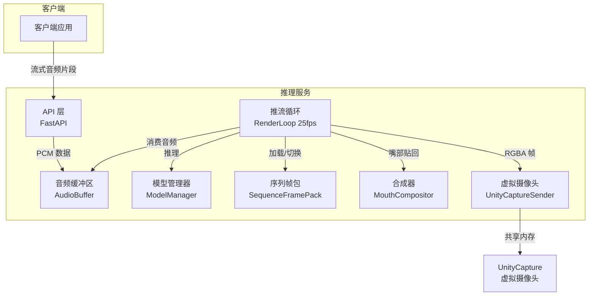
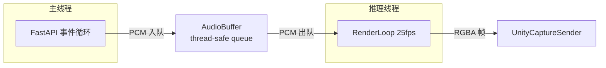
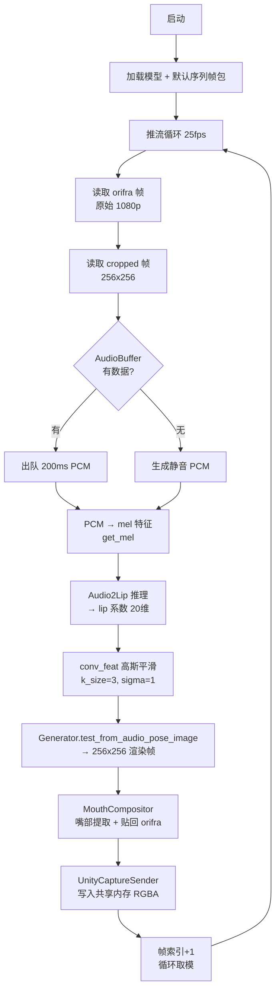
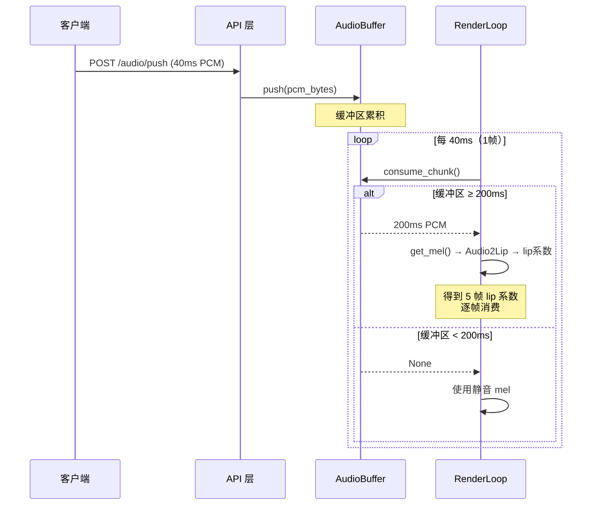
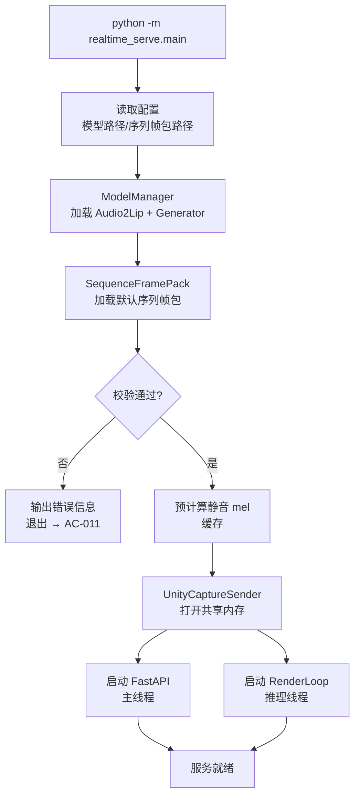

# 技术方案：实时流式推理服务

> 需求文档：`specs/features/realtime-streaming-inference.md`

## 1. 系统架构

### 1.1 整体架构



### 1.2 模块职责

| 模块 | 职责 | 对应源码参考 |
|------|------|-------------|
| `ModelManager` | 加载/持有 Audio2Lip + Generator 模型，提供推理接口 | `demo_change_a_video_lip.py:160-176` |
| `SequenceFramePack` | 加载/管理序列帧包（orifra + cropped + facemark + metadata），支持动态切换 | `PreloadedVideoReader` (demo:41-76) |
| `AudioBuffer` | 缓冲流式音频 PCM 数据，提供逐帧消费接口，静音填充 | 新模块 |
| `RenderLoop` | 25fps 主循环：读帧 → 推理 → 合成 → 推流 | `demo_change_a_video_lip.py:199-259` |
| `MouthCompositor` | 从 256x256 渲染帧提取嘴部区域，贴回 orifra 1080p 帧 | 新模块 |
| `UnityCaptureSender` | 通过 ctypes 写入 UnityCapture 共享内存 | `UnityCapture-master/Source/shared.inl` |
| `API 层` | 接收流式音频、序列帧切换请求 | 新模块 |

### 1.3 线程模型



- **主线程**：FastAPI 事件循环，处理 HTTP/WebSocket 请求，将音频 PCM 数据入队到 `AudioBuffer`
- **推理线程**：独立线程运行 `RenderLoop`，以 25fps 节拍从 `AudioBuffer` 消费音频、执行推理、合成、推流
- **AudioBuffer**：线程安全队列（`collections.deque` + `threading.Lock`），主线程写入、推理线程读取

→ AC-013（延迟 < 1s）：推理线程独立运行，不与 API 事件循环竞争

## 2. 数据模型

### 2.1 序列帧包数据结构

预处理阶段（`crop_head_video.py`）产出的目录结构：

```
<dataset_dir>/
├── orifra/<video_name>/     # 原始帧 1080p (JPEG, 最长边 1920)
│   ├── 0.jpg
│   ├── 1.jpg
│   └── ...
├── count/<video_name>/      # 裁切帧 256x256 (JPEG)
│   ├── 0.jpg
│   ├── 1.jpg
│   └── ...
├── metadata/<video_name>.npy  # 裁切坐标 (structured array)
└── facemark/<video_name>.npy  # 68点关键点 (N, 68, 2) float32
```

### 2.2 metadata.npy 结构

```python
dtype = np.dtype([
    ('frame_idx', 'i4'),      # 帧序号
    ('crop_x', 'f4'),         # 裁切区域左上角 X（原始帧坐标）
    ('crop_y', 'f4'),         # 裁切区域左上角 Y
    ('crop_size', 'f4'),      # 裁切区域边长
    ('scale_factor', 'f4'),   # 缩放因子
    ('face_detected', '?'),   # 是否检测到人脸
    ('pad_ratio', 'f4'),      # 填充比例
    ('face_bbox_x', 'f4'),    # 人脸 bbox X
    ('face_bbox_y', 'f4'),    # 人脸 bbox Y
    ('face_bbox_w', 'f4'),    # 人脸 bbox 宽
    ('face_bbox_h', 'f4'),    # 人脸 bbox 高
])
```

→ AC-015（贴回坐标基于预处理数据）：推理时直接读取 metadata 中的 `crop_x`, `crop_y`, `crop_size` 和 facemark 坐标，不做运行时检测

### 2.3 facemark.npy 结构

- 形状：`(N, 68, 2)`，float32
- N = 帧数，68 个关键点，每点 `(x, y)` 在**原始帧坐标系**
- dlib 68 点中嘴部关键点：48-67（外唇 48-59，内唇 60-67）

### 2.4 AudioBuffer 数据模型

```python
class AudioBuffer:
    MAX_BUFFER_SECONDS = 2.0          # → AC-016
    SAMPLE_RATE = 16000               # 16kHz
    CHUNK_SIZE = int(SAMPLE_RATE * 0.2)  # 200ms = 3200 samples，批量推理单位
    _buffer: deque[float]             # PCM 采样点队列
    _lock: threading.Lock
```

→ AC-016（缓冲区上限 2 秒）：`MAX_BUFFER_SECONDS = 2.0`，超出时丢弃最早数据

## 3. API 接口设计

### 3.1 接口概览

| 方法 | 路径 | 用途 | 对应 AC |
|------|------|------|---------|
| POST | `/audio/push` | 推送音频片段 | AC-002, AC-003 |
| POST | `/sequence/switch` | 切换序列帧包 | AC-004 |
| GET | `/status` | 查询服务状态 | AC-001 |

### 3.2 POST /audio/push

推送 PCM 音频片段，服务端缓冲后批量推理。

**请求：**
```json
{
  "pcm_base64": "<base64 编码的 16kHz mono 16bit PCM 数据>",
  "timestamp_ms": 12345
}
```

**响应：**
```json
{
  "ok": true,
  "buffer_ms": 180
}
```

- `pcm_base64`：Base64 编码的原始 PCM 字节（16kHz, mono, int16）
- `buffer_ms`：当前缓冲区中的音频时长（ms），供客户端监控

→ AC-002（推送音频后嘴部运动）：音频入队后，下一个批量推理周期（≤200ms）即可消费

### 3.3 POST /sequence/switch

切换序列帧包，下一帧直接使用新包。

**请求：**
```json
{
  "dataset_dir": "HDTF/subject_001",
  "video_name": "video_clip_1"
}
```

**响应：**
```json
{
  "ok": true,
  "frame_count": 125,
  "resolution": [1080, 1920]
}
```

→ AC-004（动态切换序列帧）：推理线程通过原子引用切换，下一帧直接使用新包

### 3.4 GET /status

```json
{
  "state": "running",
  "fps": 24.8,
  "buffer_ms": 180,
  "current_sequence": "subject_001/video_clip_1",
  "frame_index": 42,
  "resolution": [1080, 1920]
}
```

→ AC-014（帧率监控）：`fps` 字段反映实际推流帧率

### 3.5 协议抽象层

音频推送协议最终选型未定（WebSocket / HTTP / gRPC），设计抽象层：

```python
class AudioTransport(ABC):
    @abstractmethod
    async def receive_audio_chunk(self) -> bytes: ...

class HttpAudioTransport(AudioTransport):
    """当前实现：HTTP POST /audio/push"""

class WebSocketAudioTransport(AudioTransport):
    """后续可替换：WebSocket 流式推送"""
```

API 层通过 `AudioTransport` 接口接收音频，底层实现可替换，不影响推理逻辑。

## 4. 核心逻辑

### 4.1 推流循环主流程



→ AC-001（25fps 推流 + 无音频嘴闭合）：循环始终运行，无音频时走静音路径
→ AC-005（循环播放）：帧索引对总帧数取模
→ AC-007（音频中断→静音）：AudioBuffer 为空时自动走静音路径
→ AC-008（缓冲区空→静音填充）：同上

### 4.2 模型管理器

```python
class ModelManager:
    def __init__(self, model_path, audio2lip_model_path, device='cuda'):
        self.audio2lip = Audio2Lip().to(device)
        # 加载权重，参考 demo_change_a_video_lip.py:168-171
        self.gen = Generator().to(device)
        # 加载权重，参考 demo_change_a_video_lip.py:172-175

    def infer_lip(self, mel_input, bs, T) -> Tensor:
        """Audio2Lip 推理 → lip 系数 [T, 20]"""
        with torch.no_grad():
            lip = self.audio2lip(mel_input, bs, T)[0]
            lip = conv_feat(lip, k_size=3, sigma=1)
        return lip

    def infer_frame(self, img_source, alpha_D_lip, pose_img_drive) -> Tensor:
        """Generator 推理 → 256x256 渲染帧 [1,3,256,256]"""
        with torch.no_grad():
            return self.gen.test_from_audio_pose_image(
                img_source, alpha_D_lip, pose_img_drive, h_start=None
            )
```

复用现有模型类 `Audio2Lip`（`networks/audio_encoder.py:26`）和 `Generator`（`networks/generator_lip_pose.py:134`），推理逻辑与 `demo_change_a_video_lip.py:207,230` 一致。

### 4.3 序列帧包

```python
class SequenceFramePack:
    def __init__(self, dataset_dir, video_name, device='cuda'):
        orifra_dir = f"{dataset_dir}/orifra/{video_name}"
        crop_dir = f"{dataset_dir}/count/{video_name}"

        # 一次性加载所有帧到 GPU（参考 PreloadedVideoReader）
        self.orifra_frames = self._load_orifra(orifra_dir)       # list[np.ndarray] 1080p BGR
        self.crop_frames = self._load_crop_gpu(crop_dir, device)  # [N, 3, 256, 256] GPU tensor [-1,1]
        self.metadata = np.load(f"{dataset_dir}/metadata/{video_name}.npy")
        self.facemark = np.load(f"{dataset_dir}/facemark/{video_name}.npy")  # [N, 68, 2]
        self.total_frames = len(self.orifra_frames)

    def get_frame(self, idx) -> tuple:
        """获取第 idx 帧（循环），返回 (orifra, cropped, meta, facemark)"""
        actual = idx % self.total_frames
        return (
            self.orifra_frames[actual],
            self.crop_frames[actual:actual+1],
            self.metadata[actual],
            self.facemark[actual],
        )
```

→ AC-005（循环播放）：`idx % self.total_frames`
→ AC-011（数据不完整→启动失败）：`__init__` 中校验路径和文件完整性，失败抛异常

### 4.4 音频缓冲区

```python
class AudioBuffer:
    MAX_SAMPLES = 16000 * 2  # 2秒 → AC-016
    CHUNK_SAMPLES = 16000 * 0.2  # 200ms 批量推理单位

    def __init__(self):
        self._buf = deque()
        self._lock = threading.Lock()

    def push(self, pcm: bytes):
        """主线程调用：推送 PCM 数据"""
        samples = np.frombuffer(pcm, dtype=np.int16).astype(np.float32)
        with self._lock:
            self._buf.extend(samples.tolist())
            # → AC-009：超出上限丢弃最早数据
            while len(self._buf) > self.MAX_SAMPLES:
                self._buf.popleft()

    def consume_chunk(self) -> np.ndarray | None:
        """推理线程调用：取出一个 CHUNK（200ms）用于推理"""
        with self._lock:
            if len(self._buf) < self.CHUNK_SAMPLES:
                return None  # → AC-008：缓冲不足，返回 None，调用方使用静音
            chunk = np.array([self._buf.popleft() for _ in range(self.CHUNK_SAMPLES)])
        return chunk

    def buffer_duration_ms(self) -> float:
        with self._lock:
            return len(self._buf) / 16000.0 * 1000
```

→ AC-008（缓冲区空→静音）：`consume_chunk` 返回 None
→ AC-009（缓冲区满→丢弃最早）：`push` 中 popleft
→ AC-016（上限 2 秒）：`MAX_SAMPLES = 32000`

### 4.5 静音音频生成

```python
def generate_silent_mel() -> tuple:
    """生成静音 mel 特征（全零 PCM → mel），结果缓存"""
    if _SILENT_MEL_CACHE is not None:
        return _SILENT_MEL_CACHE
    silent_pcm = np.zeros(int(16000 * 0.2), dtype=np.float32)  # 200ms 静音
    wav_length, num_frames = parse_audio_length(len(silent_pcm), 16000, 25)
    silent_pcm = crop_pad_audio(silent_pcm, wav_length)
    mel = audio.melspectrogram(silent_pcm).T
    # ... 与 get_mel 相同的滑动窗口逻辑
    _SILENT_MEL_CACHE = (mel_input, bs, T)
    return _SILENT_MEL_CACHE
```

静音 mel 只计算一次并缓存，后续直接复用。→ AC-007, AC-008

### 4.6 嘴部合成器

```python
class MouthCompositor:
    MOUTH_LANDMARK_IDS = list(range(48, 68))  # dlib 嘴部 20 个关键点

    def composite(self, orifra_frame, rendered_frame_256, facemark, meta) -> np.ndarray:
        """
        将 256x256 渲染帧的嘴部区域贴回 orifra 原始帧

        Args:
            orifra_frame: 原始 1080p 帧 (H, W, 3) BGR uint8
            rendered_frame_256: 渲染帧 (256, 256, 3) BGR uint8
            facemark: (68, 2) float32 原始帧坐标
            meta: 单帧 metadata structured array

        Returns:
            合成后的 1080p 帧 (H, W, 3) BGR uint8
        """
        result = orifra_frame.copy()

        # 1. 从 facemark 取嘴部关键点（原始帧坐标）
        mouth_pts = facemark[self.MOUTH_LANDMARK_IDS]  # (20, 2)

        # 2. 计算嘴部 bbox（原始帧坐标）
        mouth_x1 = int(np.min(mouth_pts[:, 0]))
        mouth_y1 = int(np.min(mouth_pts[:, 1]))
        mouth_x2 = int(np.max(mouth_pts[:, 0]))
        mouth_y2 = int(np.max(mouth_pts[:, 1]))

        # 3. 映射到 256x256 裁切帧坐标
        crop_x, crop_y = meta['crop_x'], meta['crop_y']
        crop_size = meta['crop_size']
        scale = 256.0 / crop_size

        mouth_in_crop_x1 = (mouth_x1 - crop_x) * scale
        mouth_in_crop_y1 = (mouth_y1 - crop_y) * scale
        mouth_in_crop_x2 = (mouth_x2 - crop_x) * scale
        mouth_in_crop_y2 = (mouth_y2 - crop_y) * scale

        # 4. 从渲染帧提取嘴部区域
        m_x1 = max(0, int(mouth_in_crop_x1))
        m_y1 = max(0, int(mouth_in_crop_y1))
        m_x2 = min(256, int(mouth_in_crop_x2))
        m_y2 = min(256, int(mouth_in_crop_y2))
        mouth_region = rendered_frame_256[m_y1:m_y2, m_x1:m_x2]

        # 5. 创建 mask 并做边缘羽化融合
        mask = self._create_feather_mask(mouth_region.shape[:2], feather_ratio=0.15)
        # ... 将 mouth_region 通过 mask 混合到 orifra 对应位置

        return result

    def _create_feather_mask(self, shape, feather_ratio=0.15) -> np.ndarray:
        """创建带羽化边缘的 mask，避免贴回接缝"""
        h, w = shape
        mask = np.ones((h, w), dtype=np.float32)
        feather = int(min(h, w) * feather_ratio)
        # 四边渐变
        for i in range(feather):
            alpha = i / feather
            mask[i, :] = min(mask[i, :].min(), alpha)
            mask[h-1-i, :] = min(mask[h-1-i, :].min(), alpha)
            mask[:, i] = min(mask[:, i].min(), alpha)
            mask[:, w-1-i] = min(mask[:, w-1-i].min(), alpha)
        return mask
```

→ AC-006（嘴部贴回 + 自然融合）：仅贴嘴部区域，羽化 mask 消除接缝
→ AC-015（坐标基于预处理数据）：facemark 和 metadata 来自预处理 npy 文件

### 4.7 UnityCapture 推流

```python
class UnityCaptureSender:
    HEADER_SIZE = 32
    MAX_SHARED_SIZE = 3840 * 2160 * 4 * 2
    FORMAT_UINT8 = 0

    def __init__(self, cap_num=0):
        """打开 UnityCapture 共享内存对象"""
        self.cap_num = cap_num
        # 通过 ctypes 打开命名内核对象
        self.h_mutex = kernel32.OpenMutexW(SYNCHRONIZE, False, f"UnityCapture_Mutx{cap_num}")
        self.h_want = kernel32.CreateEventW(None, False, False, f"UnityCapture_Want{cap_num}")
        self.h_sent = kernel32.OpenEventW(EVENT_MODIFY_STATE, False, f"UnityCapture_Sent{cap_num}")
        self.h_map = kernel32.OpenFileMappingW(FILE_MAP_WRITE, False, f"UnityCapture_Data{cap_num}")
        self.p_buf = kernel32.MapViewOfFile(self.h_map, FILE_MAP_WRITE, 0, 0, 0)

    def send_frame(self, bgr_frame: np.ndarray, timeout_ms=100):
        """
        发送一帧到虚拟摄像头

        Args:
            bgr_frame: (H, W, 3) BGR uint8 数组
            timeout_ms: 写入超时（ms），→ AC-012
        """
        h, w = bgr_frame.shape[:2]
        rgba = cv2.cvtColor(bgr_frame, cv2.COLOR_BGR2RGBA)

        # 写入共享内存 header + pixel data
        kernel32.WaitForSingleObject(self.h_mutex, timeout_ms)
        # ... 写入 header (maxSize, width, height, stride, format, ...)
        # ... 写入 pixel data (RGBA bytes)
        kernel32.ReleaseMutex(self.h_mutex)
        kernel32.SetEvent(self.h_sent)
```

→ AC-012（虚拟摄像头未读取→不阻塞）：mutex 等待使用短超时（100ms），超时跳过

### 4.8 序列帧包动态切换

```python
class RenderLoop:
    def __init__(self):
        self._frame_pack: SequenceFramePack = None
        self._frame_pack_lock = threading.Lock()

    def switch_sequence(self, dataset_dir, video_name):
        """API 线程调用：加载新包并原子替换"""
        new_pack = SequenceFramePack(dataset_dir, video_name)
        with self._frame_pack_lock:
            old_pack = self._frame_pack
            self._frame_pack = new_pack
        # 释放旧包 GPU 显存
        if old_pack is not None:
            del old_pack

    def _get_current_pack(self) -> SequenceFramePack:
        with self._frame_pack_lock:
            return self._frame_pack
```

→ AC-004（切换不中断推流）：原子引用替换，推理线程下一帧自动使用新包
→ AC-010（分辨率自适应）：新包的 orifra 帧尺寸可能不同，UnityCapture 推流时自动适配 width/height

### 4.9 帧率控制

```python
class RenderLoop:
    TARGET_FPS = 25
    FRAME_INTERVAL = 1.0 / TARGET_FPS  # 40ms

    def run(self):
        while self._running:
            t_start = time.perf_counter()

            # ... 推理 + 合成 + 推流 ...

            elapsed = time.perf_counter() - t_start
            sleep_time = self.FRAME_INTERVAL - elapsed
            if sleep_time > 0:
                time.sleep(sleep_time)
            # 帧率波动监控
            self._actual_fps = 1.0 / max(elapsed, self.FRAME_INTERVAL)
```

→ AC-014（帧率 25fps ±2fps）：精确节拍控制 + 帧率监控

## 5. 音频处理流水线（方案 B：缓冲+批量推理）



关键设计：
- **批量单位 200ms**：累积到 200ms PCM 后一次性调用 `get_mel` + `Audio2Lip`，得到 5 帧 lip 系数
- **lip 系数缓存**：一次批量推理产出 5 帧 lip 系数，缓存在 RenderLoop 中逐帧消费
- **静音填充**：AudioBuffer 不足 200ms 时使用预计算的静音 mel

→ AC-002（延迟 < 1s）：最大延迟 = 200ms（缓冲等待）+ 40ms（1帧推理）+ 40ms（合成+推流）≈ 280ms
→ AC-003（持续音频无卡顿）：批量推理产出多帧 lip 系数，逐帧平滑消费

## 6. 异常处理

| 异常场景 | 处理方式 | 对应 AC |
|----------|----------|---------|
| 序列帧包路径不存在/数据不完整 | `SequenceFramePack.__init__` 校验失败，抛 `FileNotFoundError`，服务启动拒绝进入推流循环 | AC-011 |
| 音频流中断（客户端停止推送） | `AudioBuffer.consume_chunk` 返回 None，RenderLoop 自动切换静音模式 | AC-007 |
| 音频推送速度 > 消费速度 | `AudioBuffer.push` 检测超出 `MAX_SAMPLES`，丢弃最早数据 | AC-009 |
| 音频推送速度 < 消费速度 | `AudioBuffer.consume_chunk` 返回 None，使用静音 mel 填充 | AC-008 |
| UnityCapture 虚拟摄像头未被读取 | mutex 等待超时 100ms 后跳过，推流循环不阻塞 | AC-012 |
| 序列帧包切换时分辨率变化 | 新包加载后，orifra 帧尺寸自动变化，UnityCapture 推流时写入新的 width/height | AC-010 |
| GPU 推理异常 | 捕获 CUDA 异常，跳过当前帧，继续下一帧推流（显示原始 orifra 帧） | AC-014 |

## 7. 项目文件结构

```
realtime_serve/
├── __init__.py
├── main.py                  # 启动入口：加载模型 → 启动 API + 推流线程
├── config.py                # 配置：模型路径、序列帧包路径、帧率等
├── models.py                # ModelManager：模型加载与推理
├── audio_buffer.py          # AudioBuffer：线程安全音频缓冲区
├── audio_processor.py       # 音频处理：PCM→mel、静音mel、get_mel 复用
├── sequence_frame_pack.py   # SequenceFramePack：序列帧包加载与管理
├── compositor.py            # MouthCompositor：嘴部提取与贴回合成
├── render_loop.py           # RenderLoop：25fps 推流主循环
├── unity_capture.py         # UnityCaptureSender：虚拟摄像头推流
├── api/
│   ├── __init__.py
│   ├── app.py               # FastAPI 应用
│   ├── routes_audio.py      # /audio/push
│   ├── routes_sequence.py   # /sequence/switch
│   ├── routes_status.py     # /status
│   └── transport.py         # AudioTransport 抽象层
└── utils/
    ├── __init__.py
    └── timing.py             # 帧率控制与监控
```

## 8. AC 覆盖检查

| AC | 覆盖模块 | 覆盖点 |
|----|----------|--------|
| AC-001 | RenderLoop | 25fps 循环始终运行，无音频走静音路径 |
| AC-002 | AudioBuffer + RenderLoop | 音频入队后 ≤200ms 被批量推理消费 |
| AC-003 | AudioBuffer + audio_processor | 批量推理产出多帧 lip 系数，逐帧消费 |
| AC-004 | RenderLoop.switch_sequence | 原子引用替换，下一帧使用新包 |
| AC-005 | SequenceFramePack.get_frame | idx % total_frames 循环取模 |
| AC-006 | MouthCompositor | 仅贴嘴部区域 + 羽化 mask 融合 |
| AC-007 | AudioBuffer + RenderLoop | consume_chunk 返回 None → 静音模式 |
| AC-008 | AudioBuffer + RenderLoop | 缓冲不足 → 静音 mel 填充 |
| AC-009 | AudioBuffer.push | 超出 MAX_SAMPLES 丢弃最早数据 |
| AC-010 | SequenceFramePack + UnityCaptureSender | 新包分辨率自动适配，推流写入新 width/height |
| AC-011 | SequenceFramePack.__init__ | 路径校验 + 文件完整性校验，失败抛异常 |
| AC-012 | UnityCaptureSender.send_frame | mutex 等待超时 100ms，超时跳过 |
| AC-013 | 整体流水线 | 延迟 ≈ 200ms(缓冲) + 40ms(推理) + 40ms(合成推流) ≈ 280ms < 1s |
| AC-014 | RenderLoop | 精确节拍控制 + 帧率监控 |
| AC-015 | MouthCompositor | 坐标来自 facemark.npy + metadata.npy |
| AC-016 | AudioBuffer | MAX_BUFFER_SECONDS = 2.0 |

## 9. 性能预算

| 环节 | 耗时估算 | 说明 |
|------|----------|------|
| 音频缓冲等待 | ≤200ms | 批量推理单位 |
| PCM → mel | ~5ms | 200ms 音频的 mel 计算 |
| Audio2Lip 推理 | ~10ms | 单次前向传播 |
| conv_feat 平滑 | ~1ms | 1D 卷积 |
| Generator 推理 | ~25ms | test_from_audio_pose_image 单帧 |
| 嘴部合成 | ~3ms | numpy 切片 + mask 混合 |
| UnityCapture 写入 | ~2ms | 共享内存 memcpy |
| **总计** | **~246ms** | **远低于 1s 延迟预算** |

## 10. 启动流程


